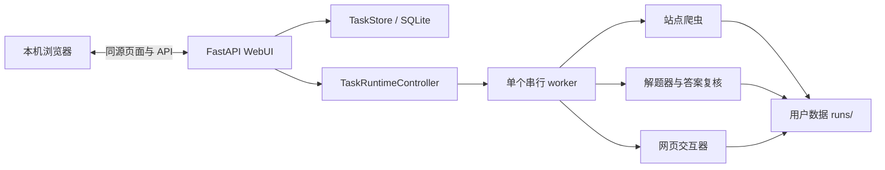

# AutoLearn 架构与目录

> 架构梳理日期：2026-10-17。当前项目规范以根目录 `AGENTS.md` 和 `README.md` 为准；旧前端方案已移入 `docs/archive/`。

## 架构概览

AutoLearn 是一个本机 localhost WebUI。FastAPI 服务和任务运行时在当前用户会话中运行，Uvicorn 只监听 `127.0.0.1`。浏览器加载项目内静态页面，通过同源 JSON API 操作任务域；一个纯 Python worker 串行处理抓取、解题和交互。



典型任务流：

1. WebUI 创建任务后直接进入登录验证向导。任务级 Cookie 状态由认证事件和当前本机 Cookie 配置共同判断。
2. 抓取 Cookie 完成后进入抓取题目；题包生成后进入检查题包。题包复核通过后才能进入模型授权。抓取失败且尚未生成题包时，任务可以带 `retry_failed=true` 重新抓 Cookie 并退回 `draft`；已生成题包的失败任务不允许刷新 Cookie。
3. 模型授权页允许重新选择模型档案；用户确认服务目的地、题数和图片数后启动解题。
4. 解题页显示阶段进度；解题完成后自动进入答案复核。
5. 答案复核页的“填写答案”直接启动网页填写，不再显示独立填写页。交互器检查结构、填写并核对回显。
6. 后端持久化 `awaiting_submit_confirmation`，WebUI 进入提交确认步骤。确认后，适配器重新检查当前提交控件，并根据网页证据记录结果。

任务页面显示安全状态。普通任务响应不返回完整 URL、Cookie、API key 或提交确认令牌；一次性确认 ID 只通过专用流程处理。

## 代码目录

```text
AutoLearn/
├── AGENTS.md                      项目开发约定
├── README.md                      安装、启动和使用说明
├── pyproject.toml                 Python 包元数据与 WebUI 命令入口
├── requirements.txt               固定的运行依赖
├── run.bat                        启动 WebUI
├── rerun.bat                      结束旧服务并重新启动 WebUI
├── docs/
│   ├── architecture.md            当前架构与数据流
│   └── archive/
│       ├── README.md              历史文档说明
│       └── frontend_task_plan.md  历史前端方案，不作为当前规范
├── core/
│   ├── paths.py                   只读资源和用户数据路径边界
│   ├── data_migration.py          旧配置、题包、日志迁移与回滚
│   ├── credentials.py             后端按需读取 Cookie 和模型配置
│   ├── url_protection.py          Windows DPAPI CurrentUser URL 保护
│   ├── auth/                      Cookie Manager
│   ├── common/                    通用 JSON Schema 校验
│   ├── settings/                  模型档案和本地配置存储
│   ├── tasks/
│   │   ├── models.py              任务、队列和事件模型
│   │   ├── store.py               SQLite 持久化、状态和队列
│   │   └── runtime.py             单 worker、阶段授权和取消协调
│   ├── solver/
│   │   ├── runner.py              题包校验、模型请求和答案生成
│   │   ├── answer_review.py       本地答案查看、编辑和复核
│   │   └── prompt.md              解题提示词资源
│   ├── interaction/               通用交互运行入口和题包校验
│   ├── adapters/
│   │   ├── chaoxing/              超星爬取、校验、交互和 Schema
│   │   └── cjyuketang/            长江雨课堂爬取、校验、交互和 Schema
│   └── webui/
│       ├── app.py                 FastAPI 路由、安全检查和启动参数
│       └── static/                本机 HTML、CSS、JavaScript
```

运行时代码使用 `core.paths.resource_path()` 定位 Schema、README、prompt 和静态资源，使用 `core.paths.data_path()` 定位配置、题包、日志和 SQLite。Cookie 抓取的浏览器 profile 是每次运行新建的系统临时目录，不属于用户数据。禁止用当前工作目录或源码文件位置推导可写用户数据路径。

## 模块边界

| 模块 | 主要职责 |
| --- | --- |
| `core.webui` | 本机页面、API 入参校验、任务域调用和安全 JSON 响应 |
| `core.tasks` | SQLite 任务状态、队列、运行时事件和提交确认持久化 |
| `core.auth` | 可见 Cookie Manager 和每次抓取新建的临时 Chrome profile |
| `core.adapters` | 站点抓取、题包 Schema、交互映射和页面操作 |
| `core.solver` | Schema 与附件校验、模型请求、答案生成和复核 |
| `core.interaction` | 通用题包检查、适配器加载和执行结果校验 |
| `core.settings` / `core.credentials` | 模型档案、Cookie 和 API 密钥的后端读取 |
| `core.paths` / `core.data_migration` | 资源与用户数据隔离，以及旧数据安全迁移 |

## WebUI 入口与安全

从项目根目录启动：

```powershell
.\.venv\Scripts\python.exe -m core.webui --open-browser
```

默认地址为 `http://127.0.0.1:8877`。`--port <1024-65535>` 可指定其他端口；服务仍只绑定 loopback。写请求会检查客户端地址、Host 和与当前服务匹配的 Origin。页面资源从本地提供，响应设置 `no-store` 和同源 CSP。

主要 API 分组：

| 功能 | 路由范围 |
| --- | --- |
| 元数据与任务 | `/api/meta`、`/api/overview`、`/api/tasks` |
| 草稿设置与题目复核 | `/api/tasks/{task_id}`、`draft-settings`、`review`、`answers` |
| 登录、抓取和队列 | `/authenticate`、`crawl`、`resume`、`stop`、`archive` |
| 模型请求授权 | `/model-authorization` 及其 `/response` |
| 网页交互与一次性提交确认 | `/interaction`、`/interaction/retry`、`/submit-confirmation` |
| 模型档案 | `/api/profiles`、`/api/profiles/{profile_id}` DELETE 及其 `/default`、`/test` 连通性探测 |
| 本机服务关闭 | `/api/shutdown` |
| 题包图片 | `/api/tasks/{task_id}/assets/{path}` |

任务状态 API 仅输出允许展示的字段。模型 API 密钥不返回浏览器；任务 URL 只在明确的草稿编辑接口可读；提交确认 ID 只在专用一次性接口中传递。

## 用户数据与迁移

Windows 用户数据根目录为 `%LOCALAPPDATA%\AutoLearn`，包含：

- `config.json`：模型档案和站点 Cookie。
- `tasks.sqlite3`：任务、队列、运行状态和事件。
- `runs/<run_id>/`：题目、交互映射、答案、图片和执行结果。
- `logs/`：只记录必要汇总和安全错误分类。
- `ChromeProfiles/`：旧版本遗留的浏览器 profile；当前版本不再写入，可删除。
- `backups/`：迁移源和 SQLite 备份。

WebUI 和独立 CLI 首次启动会迁移旧源码目录里的 `config.json`、`runs/` 和 `logs/`。迁移会验证来源、备份并校验副本；旧来源保留。遇到无效配置、目标冲突或复制失败时不会覆盖已有数据。SQLite schema 升级使用 SQLite backup API 并在事务中完成。

Windows SQLite 中完整任务 URL 使用 DPAPI CurrentUser 加密。加密或解密失败时安全失败，不回退明文；数据绑定当前 Windows 用户和设备。

## 依赖与浏览器

`requirements.txt` 与 `pyproject.toml` 保持一致，固定依赖为：

- `fastapi==0.143.3`
- `uvicorn==0.54.0`
- `scrapling[fetchers]==0.4.15`

Cookie Manager 的 `DynamicSession(real_chrome=True)` 要求本机 Chrome Stable x64，不操作用户默认 profile。每次抓取都会在系统临时目录新建空的 profile 目录并在结束时删除，因此浏览器总是以未登录状态启动，Cookie 和登录状态不会跨次留存。普通 Scrapling 浏览器组件需由用户主动执行 `scrapling install` 安装，并与运行项目的 Python 环境匹配；服务启动时不会静默下载浏览器。

适配器可选声明 `CAPTURE_START_URL`（抓 Cookie 时浏览器首先打开的地址，必须是允许域名下的 HTTPS）和 `CAPTURE_HINT`（WebUI 弹窗里的操作提示）。雨课堂用它先打开首页 `/web`，由用户登录后手动进入目标页；任务 URL 仍用于限定 Cookie 作用域。Cookie 采集会对任务 URL 与用户实际停留页面各取一次并按名称去重（先取的优先），避免从首页进入后丢失 Cookie。

## 站点契约

- [超星适配器 README](../core/adapters/chaoxing/README.md)：题包、附件、交互和 UEditor 控件映射。
- [长江雨课堂适配器 README](../core/adapters/cjyuketang/README.md)：异步题目挂载、图片型选项、选择器校验和交互流程。
