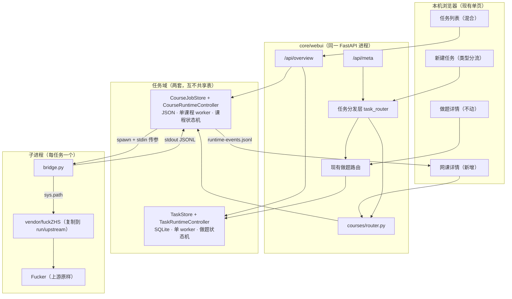
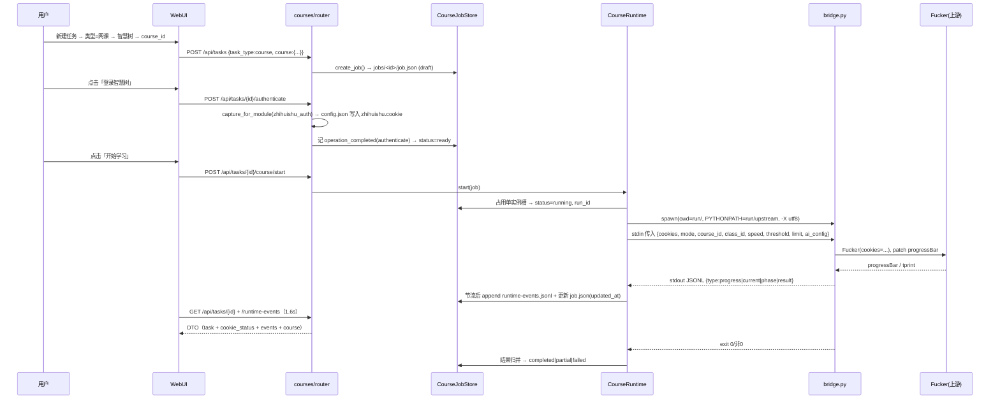
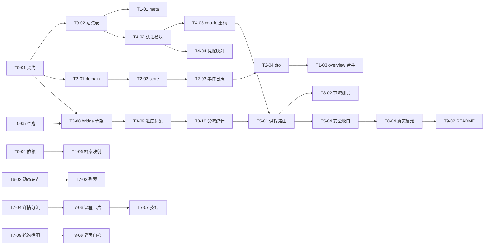

# AutoLearn 网课模块（fuckZHS 融合）任务分布书

| 项目 | 内容 |
| --- | --- |
| 文档版本 | v1.0 |
| 依据文档 | 根目录 `TASK_BOOK_MULTI_TYPE_TASK_CENTER_AND_ONLINE_COURSE.md`（v0.2） |
| 代码基线 | AutoLearn v1.0.4 + 本机未发布的 WebUI 改动；fuckZHS v2.6.3（`meta.json`） |
| 编写日期 | 2026-10-23 |
| 文档性质 | 实施级工作分解（WBS）+ 分工 + 验收门，不改动任何代码 |
| 读者 | 实施者（人或 Agent）、评审者 |
| 目标 | 把任务书的 7 个阶段拆成可独立派发、可独立验收、互不撞车的任务卡 |

---

## 0. 如何使用本文档

1. **先看第 2 章「基线核对」**。任务书是设计稿，本文件把设计稿逐条对到了现有代码上，列出 20 条必须调整的地方。**不读第 2 章就开工，会在第 3 天撞墙。**
2. **按第 5 章派发任务**。每个任务卡含 ID、前置依赖、涉及文件、验收标准、人日。任务卡可直接贴给执行者。
3. **守住第 6 章的文件所有权**。同一文件同一时段只允许一个写入者，否则前端两个工作包必然冲突。
4. **过第 7 章的质量门**。G0～G5 是硬门，不许跳。
5. 第 9 章附录是与任务书章节的映射表，评审时按它逐条对账。

---

## 1. 阅读结论与执行摘要

### 1.1 任务书要什么

在 AutoLearn 现有「做题」工作区旁边，**新增一个平级的「网课」任务类型**：共用同一套任务列表、详情外壳和 1.6 秒轮询；网课侧用独立存储、独立状态机、独立运行时，通过子进程桥接驱动 fuckZHS 的 `Fucker`，**不重写 `fucker.py`**。

### 1.2 本文件的三条判断

**判断一：任务书的技术路线是对的，可以直接落地。**
`fucker.py` 的进度输出确实走 `progressBar` 这个模块级名字（`fucker.py:2` 从 `utils` 导入），在子进程里替换它即可拿到进度；`Fucker.__init__` 的入参已经足够（`cookies/speed/end_thre/limit/tree_view/progressbar_view`），无需改上游签名。

**判断二：任务书有 4 处会直接导致返工的偏差**，已在第 2 章标注为 🔴：

- 🔴 **智慧树不能注册成 `core/adapters/zhihuishu`**。`TaskStore._discover_site_ids()` 靠目录探测，要求 `auth.py / crawler.py / solver.py / interaction.py` 四个文件齐全；一旦补齐这四个文件，智慧树会立刻出现在**做题**站点下拉里，并接受 `POST /api/tasks`，把一个没有抓题能力的站点暴露进做题流程。网课站点必须走独立的站点能力表。
- 🔴 **前端 `refreshDetail()` 的变更检测不含课程进度**（`app.js:371` 只用 `updated_at/status/queue_state/queue_position/interaction_retry_authorized` 拼 revision）。课程进度在 `course` 对象里，若后端不把进度变化写进 `updated_at`，页面会**一直显示第一帧**。
- 🔴 **子进程的 `print` 会污染 JSONL 协议**。上游到处是 `print`（`tprint`、`wipeLine`），而 `main.py` 之外没有统一的输出去向。必须在 bridge 启动时先把 fd 1 复制成事件通道，再把 fd 1 重定向到 stderr。
- 🔴 **AI 课程在无终端环境下会直接失败**。`fuckAiCourse()` 里 `w = os.get_terminal_size().columns-1` **没有 try 兜底**（`fucker.py:1279`），而子进程 stdout 是管道 → 抛 `OSError` → 被外层 `except` 转成 `Failed to get knowledge points`。共享课和校内课各自有 try 兜底，唯独 AI 课没有。必须在 bridge 里打补丁。

**判断三：工作量大头不在「接 fuckZHS」，而在「让两套状态语义共存而不互相污染」。**
按本文件拆解，**总量 ≈ 55 人日**（含自测，不含真实账号联调的空等时间）：

| 工作包 | 人日 | 占比 |
| --- | --- | --- |
| WP0 契约与地基 | 3.5 | 6% |
| WP1 后端兼容层 | 5.25 | 10% |
| WP2 课程领域与存储 | 6.5 | 12% |
| WP3 运行时与子进程桥 | 10.25 | 19% |
| WP4 智慧树适配与 vendor | 6.5 | 12% |
| WP5 路由与安全 | 3.5 | 6% |
| WP6 前端新建任务 | 3.75 | 7% |
| WP7 前端列表与详情 | 6.25 | 11% |
| WP8 测试与回归 | 7.5 | 14% |
| WP9 文档与发布 | 2.0 | 4% |
| **合计** | **55.0** | 100% |

其中**真正碰 fuckZHS 的只有 WP4（6.5 人日）**，其余 88% 是 AutoLearn 侧的兼容层与界面。这个比例符合任务书「优先让后端适配现有前端」的原则。

### 1.3 与任务书的三处主动偏离（需评审确认）

| 编号 | 任务书写法 | 本文件建议 | 理由 |
| --- | --- | --- | --- |
| DEV-01 | 课程摘要含 `run_id` | 摘要 `run_id = null`，课程运行标识放 `course.run_id` | 前端 `openDeleteTaskDialog()` 用 `Boolean(task.run_id)` 判断「删除任务 vs 删除任务与题包」（`app.js:1059`）。课程没有题包，若摘要带 `run_id`，菜单会显示「删除任务与题包」并要求输入 DELETE，语义完全错。 |
| DEV-02 | `POST /api/tasks` 一个接口分发两种任务 | 保留单一路径，但在 `create_task()` 入口按 `task_type` **前置校验后再分发**，不做「先建草稿再转换」 | 现有 `TaskStore.create_task()` 会立刻写 `tasks` 表并记 `task_created` 事件（`store.py:1020`）。若先建做题草稿再转换，会在做题库里留下脏记录。 |
| DEV-03 | 第六阶段做 AI 课程 | AI 课程提到**第四阶段之后立即做桥接验证**（不等到前端完成），先跑通 `fuckAiCourse` 的进程内冒烟 | AI 课是唯一有「无终端即失败」硬坑的分支（见 1.2 判断二第 4 条）。越晚发现，越可能倒逼改设计方案。 |

---

## 2. 基线核对：任务书 × 代码事实（差异台账）

> 逐条核对了任务书假设与仓库现状。**处理列即实施口径**，与任务书冲突时以本表为准。

| 编号 | 任务书假设 | 代码事实（位置） | 影响 | 处理 |
| --- | --- | --- | --- | --- |
| 🔴 C-01 | 站点列表来自 `/api/meta`，可自由增删 | `/api/meta` 的 `adapters` 来自 `store.supported_site_ids`（`app.py:363`），而它由 `_discover_site_ids()` 扫描 `core/adapters/*` 且要求 4 个文件齐全（`store.py` 末尾） | 不能把智慧树放进 `core/adapters` | 新建 `core/courses/sites.py` 作为**课程站点能力的唯一事实源**；`/api/meta` 合并输出，不动 `supported_site_ids` |
| 🔴 C-02 | `_task_json()` 只需加 `task_type` | `_task_json()` 是白名单函数（`app.py:126`），额外调用 `_authentication_hint()`（`app.py:112`），后者 `importlib.import_module("core.adapters.<site>.auth")` | 课程站点导入必然失败 → hint 恒为 None | 课程摘要由 `courses/dto.py` 自己产出，`authentication_hint` 从课程站点表取；`_task_json()` 只加一个 `task_type` 参数 |
| 🟠 C-03 | `cookie_status.captured` 复用现有判定 | 现有判定是 `store.has_completed_authentication(task_id)`（`app.py:107`），查的是 `task_events` 表里 `operation_completed + authenticate` | 课程任务不在 `tasks` 表，查它会抛 `KeyError` → 404 | 课程 `cookie_status.captured` 由 `CourseJobStore` 自己的认证事件产出；`configured` 仍读 `LocalCredentialProvider` |
| 🟠 C-04 | 复用 Cookie Manager | `LocalCredentialProvider._SITE_COOKIE_FIELDS` 只有 `chaoxing / cjyuketang`（`credentials.py:19`），其它 site 直接抛错 | 课程的 `configured` 恒为 False，界面永远显示未登录 | 增加 `"zhihuishu": ("zhihuishu", "cookie")`；并规定 config.json 新增 `zhihuishu.cookie` 段 |
| 🔴 C-05 | 课程认证复用同一接口 | `capture_for_adapter(site_id, ...)`（`cookie_manager.py:475`）内部 `_load_adapter(site_id)` 硬编码 `core.adapters.<site_id>.auth`，并校验 7 个必需属性 | 课程模块拿不到抓 Cookie 的能力，除非污染 adapters 目录 | 重构：抽出 `capture_for_module(adapter, page_url, ...)`，`capture_for_adapter()` 变成「加载 adapter 后调用它」的薄包装。做题路径行为不变 |
| 🔴 C-06 | 详情轮询自然刷新进度 | `refreshDetail()` 的 revision = `updated_at + status + queue_state + queue_position + interaction_retry_authorized`（`app.js:371`），进度在 `course` 对象里 | 进度变化不触发 `renderDetail()`，页面卡在第一帧 | 双保险：① 后端每次进度更新都刷新 `job.updated_at`；② 前端 revision 追加 `course.progress_percent + current_title + phase` |
| 🔴 C-07 | 状态/步骤常量直接扩充 | `STATUS_LABELS`（`app.js:3`）、`WIZARD_STEPS`（`app.js:23`）、`renderStepper()`（`app.js:556`）都是**全局常量 + 硬编码遍历** | 课程步骤条会串成做题的七步 | `renderStepper(task)` 已接收 task，改为按 `task_type` 选步骤表；新增 `COURSE_STEPS` 常量，不改 `WIZARD_STEPS` |
| 🟠 C-08 | 任务卡片显示阶段 | 卡片阶段取 `WIZARD_LABELS[wizardStepForTask(task)]`（`app.js:214`） | 课程状态（`running`）落到 `stepFromTaskStep()` 的默认分支 → 卡片显示「登录验证」 | `renderTaskList()` 里先判 `task_type`，课程走 `COURSE_STEP_LABELS[course.phase]` |
| 🟠 C-09 | 状态徽章直接复用 | `statusLabel()` 优先看 `queue_state`（`app.js:65`），`statusBadge()` 同理（`app.js:70`）；课程 `queue_state` 恒为 null | 能显示 `STATUS_LABELS[status]`，但缺 `running/stopping/partial/ready` 四个键 → 显示英文原值 | 扩 `STATUS_LABELS` + `STATUS_TONES`；`isTaskBusy()`（`app.js:552`）追加 `running/stopping` |
| 🟠 C-10 | 课程任务可复用编辑任务 | `openEditTask()` 调 `/draft-settings`（`app.js:1123`），后端要求 `status == draft`（`app.py:485`）；`PUT /api/tasks/{id}` 只允许 4 个字段（`app.py:493`） | 课程任务改参数会 409 | 课程参数用独立路由 `PUT /api/tasks/{id}/course-settings`；前端课程详情页内联编辑，不复用「新建任务」弹窗的编辑态 |
| 🔴 C-11 | 子进程 stdout 只有 JSONL | 上游 `print` 遍布 `fucker.py`（`tprint`、`wipeLine`、`main.py` 的提示）；`logger.py` 还会写 5 个文件 | 一行 `print` 就能让父进程 JSON 解析崩 | bridge 启动顺序固定为：`dup(1)` → `os.dup2(2, 1)` → 事件只写 `dup` 出来的 fd；子进程统一 `-X utf8` |
| 🔴 C-12 | 运行目录隔离靠 cwd | `logger.py:143` 在 **import 时**就执行 `getRealPath("./logs")` 并 `os.mkdir`；`getRealPath` 把相对路径解析到 **`utils.py` 所在目录**（`utils.py:66-78`），不是 cwd | 直接 import vendor 里的 `fucker` 会在**源码目录**创建 `logs/`、`aiexamAnswer/`、`AiDownloadCache/` | 必须执行任务书 §10.5 的「复制到 run dir/upstream 再 import」；且**每次运行都复制**（代价可接受，见 T4-01） |
| 🔴 C-13 | `fuckZhidaoCourse()` 失败会抛异常 | 该方法对每个视频 `except Exception` 后继续，最后正常 return（`fucker.py:477-486`）；`fuckHikeCourse()` 的 `_traverse()` 同样逐文件吞异常（`fucker.py:986`） | 父进程无法从退出码判断成败 | 结果必须在 bridge 里**重算**：跑完读 `Fucker.context` 统计完成数，桥接层自带异常计数器；两者合成 `completed / partial / failed` |
| 🟠 C-14 | 超时/时限即失败 | `TimeLimitExceeded(TimeoutError)`（`fucker.py:54`）；共享课捕获后 return，校内课逐文件捕获后继续 | 「时限到」不是失败，是部分完成 | 显式映射：`TimeLimitExceeded` → `partial`，`active_error_category = "time_limit"` |
| 🟠 C-15 | 进度条能反映全部进度 | `progressBar` 只在**实际播放**时被调（`fucker.py:596/940/1259`）；已看过的视频直接 `return` 不回调（`fucker.py:502-503`） | 用回调次数当 `completed_count` 会严重偏低 | `current` 进度来自 `progressBar`；`completed_count/total_count` 来自 context 重算（T3-10） |
| 🔴 C-16 | 模型档案可直接喂给上游 | 上游 `Openai.openaiCompletion()` 拼的是 `f"{self.baseUrl}/v1/chat/completions"`（`fucker.py:2026`）；AutoLearn 档案的 `base_url` 是**完整 endpoint**（`index.html:90` 提示、`solver/runner.py:394` 校验） | 直接传会把 URL 拼成 `.../v1/chat/completions/v1/chat/completions` | 映射函数：仅接受 path 以 `/chat/completions` 结尾的档案；`api_base = 去掉 /chat/completions 再去掉末尾 /v1`；`/responses`、`/messages` 在创建任务前拒绝 |
| 🟠 C-17 | Cookie 注入即可用 | `Fucker.cookies` setter 要求 `CASLOGC` 并能 `json.loads(unquote(...))["uuid"]`，否则 `ValueError("Cookies invalid")`（`fucker.py:123-137`） | 缺 CASLOGC 时错误信息很隐蔽 | 启动前预检 `CASLOGC` 存在性；缺失直接返回 `auth_required`，不启动子进程 |
| 🟠 C-18 | 依赖已就绪 | `fucker.py` 顶层 `import` 了 `openai`、`tiktoken`；`zd_utils` 依赖 `pycryptodome`；`utils` 依赖 `Pillow`；AutoLearn 现有依赖只有 fastapi/uvicorn/scrapling（`requirements.txt`） | 子进程 `import fucker` 直接 `ModuleNotFoundError` | 追加 4 个依赖到 `requirements.txt` + `pyproject.toml`（保持一致是项目约定）；bridge 启动自检并给出可读错误 |
| 🟡 C-19 | 课程参数可原地编辑 | `TaskStore.update_task_settings()` 只处理 4 个字段（`app.py:493`） | 课程参数无处保存 | `CourseJobStore.update_options()`，仅允许 `draft/ready/failed/partial/cancelled` 状态 |
| 🟡 C-20 | 前端筛选不影响后端 | `renderTaskList()` 是**纯本地过滤**（`app.js:185`），`refreshOverview()` 不传 status；但 `/api/tasks` 会校验 `TaskStatus(status)`（`app.py:418`） | 若某天前端改用服务端筛选，课程状态会 422 | 前端保持本地筛选；`/api/tasks` 增加可选 `task_type` 参数并把状态校验放宽到「做题 ∪ 课程」状态集 |

**核对方法**：`app.py` / `app.js` / `store.py` / `cookie_manager.py` / `credentials.py` / `models.py` 全量阅读；`fucker.py`、`utils.py`、`logger.py`、`main.py` 按调用链定位（`progressBar`、`getRealPath`、`os.get_terminal_size`、`CASLOGC`、`OpenAI`、`aiConfig`）。

---

## 3. 目标架构与边界

### 3.1 模块关系



### 3.2 新增/改动文件清单

```text
AutoLearn/
├── core/
│   ├── webui/
│   │   ├── app.py                          【改】meta、overview、create_task 分发、通用接口分发、lifespan 挂课程运行时
│   │   └── static/
│   │       ├── index.html                  【改】新建任务表单分段
│   │       ├── app.js                      【改】常量扩展 + 列表标签 + 详情分流 + 新建分流 + 轮询适配
│   │       └── styles.css                  【改】课程卡片 / 表单分区 / 课程状态色
│   ├── auth/
│   │   └── cookie_manager.py               【改】抽出 capture_for_module()，保留 capture_for_adapter() 兼容
│   ├── credentials.py                      【改】_SITE_COOKIE_FIELDS 增 zhihuishu
│   └── courses/                            【新增】
│       ├── __init__.py
│       ├── sites.py             课程站点能力表（site_id、label、task_types、mode 集合、URL 规则）
│       ├── domain.py            CourseJob / CourseStatus / CoursePhase / CourseMode / CourseOptions
│       ├── store.py             JSON 存储、原子写、索引、事件日志、归档删除、崩溃恢复
│       ├── runtime.py           spawn/stop/kill、stdout 消费、事件节流、结果归并、单实例约束
│       ├── service.py           创建/认证/启动/停止/重跑/归档/删除 的业务编排
│       ├── dto.py               摘要 / 详情 / cookie_status / events → 前端兼容 DTO
│       ├── protocol.py          JSONL 事件 schema、校验、白名单、大小与频率限制
│       ├── router.py            课程专用路由
│       ├── errors.py            CourseError 体系（safe message + 状态码）
│       └── providers/
│           └── zhihuishu/
│               ├── auth.py      Cookie 抓取适配（SITE_ID/CONFIG_SECTION/…/is_authenticated/serialize_cookies）
│               ├── bridge.py    子进程入口（参数、vendor 准备、进度适配、执行分流、结果统计）
│               ├── progress.py  progressBar 替换 + 实例方法包装 + context 统计
│               ├── aimap.py     模型档案 → ai_config 映射与拒绝规则
│               ├── preflight.py 依赖 / CASLOGC / 参数 / 终端兼容自检
│               └── vendor/
│                   └── fuckZHS/ 上游原样（清单见附录 A）
└── docs/
    ├── architecture.md                     【改】增「网课模块」章节
    └── TASK_BREAKDOWN_COURSE_MODULE.md     本文档
```

### 3.3 关键链路时序（共享课）



### 3.4 明确不做（与任务书 §17 对齐）

- 不拆分 `fucker.py`，不重写 `fuckZhidaoVideo / fuckHikeVideo / fuckAiCourse / ExamCtx`。
- 不做终端文本解析驱动状态（只认自家 JSONL）。
- 课程任务不写入 `tasks.sqlite3`。
- 不新增课程队列表（课程最多 1 个运行实例，靠 `CourseRuntime` 的站点级互斥保证）。
- 不改 `core/tasks/models.py` 的状态枚举（课程状态独立定义）。
- 不做多智慧树账号并发、多课程并发。
- 不做课程列表自动发现的完整后台（第一版手工填 `course_id`）。
- 不替换上游 AI 客户端（只做档案映射）。

---

## 4. 契约冻结（G0 交付物，先冻结再写码）

> 本章是前后端与桥接三方唯一的接口事实源。**冻结后任何改动都要走变更记录**，否则并行开发必然对不上。

### 4.1 任务摘要 DTO（`/api/overview`、`/api/tasks`、详情里的 `task`）

| 字段 | 做题任务 | 课程任务 | 说明 |
| --- | --- | --- | --- |
| `task_id` | UUID | `course-<uuid>` | 前缀是分发依据（`startswith("course-")`） |
| `task_type` | `"homework"` | `"course"` | **新增字段**，做题侧默认值由后端补，前端可缺省按 homework 处理 |
| `site_id` | 现有 | `"zhihuishu"` | |
| `title` | 现有 | 课程名或课程 ID | 沿用 `_URL_IN_TITLE` 脱敏 |
| `authentication_hint` | 现有 | 课程站点表提供 | 课程不走 `core.adapters` 导入 |
| `model_profile_id` | 现有 | AI 课程填、其它 null | |
| `run_id` | 现有 | **null**（见 DEV-01） | 课程运行标识在 `course.run_id` |
| `current_step` | 现有 | `setup/auth/catalog/learning/exam/result` | 课程不用 `TaskStep` 枚举值 |
| `status` | 现有 | 课程状态集（4.5） | |
| `created_at` / `updated_at` | 现有 | 同 | **每次进度变化必须刷新 `updated_at`** |
| `last_safe_error_category` | 现有 | `auth_required / time_limit / network / upstream / unsupported / process_exit` | |
| `last_operation` | 现有 | `authenticate / learn / exam / stop` | |
| `interrupted_operation` | 现有 | 恢复后置位 | |
| `pending_operation` | 现有 | 恒 null | |
| `interaction_retry_authorized` | 现有 | 恒 false | 前端依赖其存在，不能省 |
| `queue_state` / `queue_position` | 现有 | 恒 null | 前端 `statusLabel()` 会先看它，课程必须显式给 null |

### 4.2 任务详情响应

```json
{
  "task": { "...": "见 4.1" },
  "cookie_status": { "captured": true, "configured": true },
  "queue": null,
  "events": [ { "event_id": 1, "task_id": "course-…", "occurred_at": "…", "event_type": "course_progress", "from_status": "running", "to_status": "running", "operation": "learn", "safe_error_category": null } ],
  "course": {
    "mode": "shared",
    "course_id": "…",
    "class_id": null,
    "course_name": "高等数学",
    "phase": "learning",
    "current_title": "第 2 章 / 第 3 节 / 视频 4",
    "progress_percent": 46,
    "completed_count": 8,
    "total_count": 17,
    "failed_count": 0,
    "run_id": "…",
    "options": { "speed": 1.5, "threshold": 0.91, "time_limit_minutes": 0, "process_exam": true }
  }
}
```

约束：**不得删除现有四个键**（`task / cookie_status / queue / events`）；`events` 必须含 `occurred_at / event_type / to_status / safe_error_category` 四个字段，否则 `renderEventCard()`（`app.js:1038`）渲染空白。

### 4.3 运行时事件（`/api/tasks/{id}/runtime-events`）

```json
{ "events": [ { "sequence": 12, "task_id": "course-…", "run_id": "…", "stage": "learning", "status": "progress", "completed_count": 8, "asset_count": null, "safe_error_category": null } ],
  "latest_sequence": 12 }
```

约束：
- `sequence` 每任务单调递增，**从 run 开始重置为 1**；前端用 `after` 参数增量拉取。
- `task_id` 必须回填，前端会过滤 `event.task_id === taskId`（`app.js:379`）。
- 不返回任何 URL、Cookie、API Key、上游原始报错文本。
- 逐任务最多保留 300 条（前端也裁到 300，`app.js:381`）。

### 4.4 子进程 JSONL 协议（bridge → 父进程）

| type | 必填字段 | 频率上限 | 用途 |
| --- | --- | --- | --- |
| `hello` | `version`、`mode`、`upstream_version` | 每次运行 1 条 | 握手，父进程校验协议版本 |
| `phase` | `stage`、`status`（`started/completed/failed`） | 每阶段 2 条 | 驱动 `course.phase` 与步骤条 |
| `current` | `stage`、`title`（≤200 字符） | 2 秒 1 条 | 驱动 `course.current_title` |
| `progress` | `stage`、`current`、`total`、`percent`、`completed_count`、`total_count` | 1 秒 1 条（父进程再节流到 500ms） | 驱动进度条与计数 |
| `result` | `status`（`completed/partial/failed`）、`completed_count`、`total_count`、`failed_count`、`safe_error_category` | 每次运行 1 条 | 终局裁定 |
| `diagnostic` | `category`、`message`（≤300 字符，不含敏感信息） | 10 条/运行 | 排查用，**不直接进前端事件** |

父进程必须做：单行 ≤ 64KB（超限丢弃并计 `protocol_error`）、未知 type 丢弃、字段白名单化、非法 UTF-8 丢弃、无 `result` 即按 `failed(process_exit)` 处理。

### 4.5 状态与阶段

**课程状态**

```text
draft → authenticating → ready → running → (completed | partial | failed | cancelled)
stopping 是 running 的过渡态；archived 是终态包装；queued 保留但与第一版单实例互斥基本不出现
```

| 状态 | 进入条件 | 允许的操作 | 前端文案 |
| --- | --- | --- | --- |
| `draft` | 创建完成 | 编辑参数、登录、删除 | 草稿 |
| `authenticating` | 点击登录 | 取消 | 登录验证中 |
| `ready` | Cookie 抓取成功 | 开始学习、重新登录、编辑参数 | 待开始 |
| `running` | 子进程存活 | 停止学习、查看进度 | 学习中 |
| `stopping` | 已发出 terminate | 无（只读） | 正在停止 |
| `completed` | result=completed | 重跑、归档、删除 | 已完成 |
| `partial` | result=partial 或时限到 | 重跑、归档、删除 | 部分完成 |
| `failed` | result=failed / 非 0 退出 / 协议错误 / 无 result | 重跑（必要时重新登录） | 失败 |
| `cancelled` | 用户停止且已收尾 | 重跑、归档、删除 | 已取消 |
| `archived` | 归档 | 删除 | 已归档 |

**课程阶段**：`setup → authentication → catalog → learning → exam → result`。`exam` 仅在 `mode=ai 且 process_exam=true` 出现，否则前端跳过该段。

### 4.6 接口清单

| 方法 | 路径 | 归属 | 请求要点 | 响应要点 | 主要错误 |
| --- | --- | --- | --- | --- | --- |
| GET | `/api/meta` | WP1 | — | `task_types[]`、`adapters[].task_types`、`port` | — |
| GET | `/api/overview` | WP1 | `include_archived` | `tasks`（混合）、`queue`（仅做题）、`active_task_id` | — |
| GET | `/api/tasks` | WP1 | `search/site_id/status/include_archived/task_type` | 同上 | 422 |
| POST | `/api/tasks` | WP5 | `task_type` 缺省 homework | 摘要 DTO | 422 / 409 |
| GET | `/api/tasks/{id}` | WP5 | — | 4.2 | 404 |
| GET | `/api/tasks/{id}/runtime-events` | WP5 | `after` | 4.3 | 404 |
| POST | `/api/tasks/{id}/authenticate` | WP5 | `retry_failed` | `{task_id, operation, state}` | 409 / 422 |
| POST | `/api/tasks/{id}/stop` | WP5 | — | `{task, stopped}` | 409 |
| POST | `/api/tasks/{id}/archive` | WP5 | — | 摘要 DTO | 409 |
| DELETE | `/api/tasks/{id}` | WP5 | `mode: record` + `confirmation` | `{deleted:true}` | 422 / 409 |
| POST | `/api/tasks/{id}/course/start` | WP5 | 可选覆盖参数 | `{task_id, status}` | 409 / 422 |
| PUT | `/api/tasks/{id}/course-settings` | WP5 | 仅 `draft/ready/failed/partial/cancelled` | 摘要 DTO | 409 / 422 |
| POST | `/api/tasks/{id}/course/rerun` | WP5 | 继承旧参数 | 同上 | 409 |
| GET | `/api/courses/catalog` | WP5（增强项，可延后） | — | 课程列表缓存 | 404 |

---

## 5. 工作分解（64 个任务卡）

> 角色：**BE** 后端、**BR** 桥接/上游、**FE** 前端、**QA** 测试、**DOC** 文档。人日按「含自测、不含等账号」计。
> 每个任务卡都是独立可交付单元，**验收列写的是可执行检查点**，不是形容词。

### WP0 契约与地基（3.5 人日）

| ID | 任务要点 | 交付物 / 验收 | 角色 | 前置 | 人日 |
| --- | --- | --- | --- | --- | --- |
| T0-01 | 冻结第 4 章全部契约：DTO 字段表、JSONL 协议表、状态迁移表、接口清单。落成代码常量（`courses/protocol.py` 的 `EVENT_TYPES`、`FIELD_WHITELIST`） | 第 4 章评审通过；`protocol.py` 常量与文档逐字一致 | BE | — | 1.0 |
| T0-02 | 建 `courses/sites.py` 站点能力表：`zhihuishu → {label, task_types:["course"], modes:["shared","hike","ai"], id_pattern, allowed_domains}`；作为 `/api/meta` 的唯一来源 | 表可被 `app.py` 与 `router.py` 共用；无第二处硬编码站点名 | BE | T0-01 | 0.5 |
| T0-03 | vendor 快照：按附录 A 复制上游文件，写 `UPSTREAM.md`（版本 2.6.3、commit、复制日期、剔除清单、本地改动=无）；记录 md5 台账 | `UPSTREAM.md` 完成；`python -c "import fucker"` 在 vendor 目录可成功 | BR | — | 0.5 |
| T0-04 | 依赖落地：追加 `openai / tiktoken / Pillow / pycryptodome` 到 `requirements.txt` 与 `pyproject.toml`（版本锁定到实测可用值），记录在 `UPSTREAM.md` | 干净 venv 安装后 `import openai, tiktoken, PIL, Crypto` 均通过 | BE | T0-03 | 0.5 |
| T0-05 | 桥接空跑骨架：能 `spawn` 一个打印 `hello` 就退出的子进程，父进程解析成功 | 一次 `hello` 往返；stdout 无杂讯 | BR | T0-01 | 1.0 |

### WP1 后端兼容层（5.25 人日）

| ID | 任务要点 | 交付物 / 验收 | 角色 | 前置 | 人日 |
| --- | --- | --- | --- | --- | --- |
| T1-01 | `/api/meta` 增 `task_types`（做题/网课）与 `adapters[].task_types`。做题站点 = `store.supported_site_ids` 映射 `["homework"]`；课程站点由 `sites.py` 追加。保持 `adapters` 与 `port` 字段不变 | 现有前端 `renderMeta()` 不报错；智慧树**不出现在**做题站点列表 | BE | T0-02 | 0.75 |
| T1-02 | `_task_json()` 增 `task_type` 参数（默认 `"homework"`），做题调用点全部传默认值 | 做题任务响应多一个 `task_type:"homework"`，其它字段零变化 | BE | T1-01 | 0.5 |
| T1-03 | `/api/overview` 与 `/api/tasks` 合并课程摘要：做题列表 + `CourseJobStore.list_summaries()`。排序按 `updated_at` 倒序统一。`queue` 字段保持只含做题队列 | 手工插一条课程 job，overview 同时返回两类任务且顺序正确 | BE | WP2 T2-04 | 0.75 |
| T1-04 | 任务分发层 `webui/task_router.py`：`is_course(task_id)` 判定（前缀 + 存在性双校验，防伪造前缀造成 404 语义混乱）；统一 `get/stop/archive/delete/runtime_events/authenticate` 六类调用的转发 | 六个入口对 `course-*` 全部转发到 courses 模块；不存在时报 404 而非 500 | BE | T1-01 | 1.0 |
| T1-05 | 通用接口按类型分发改造：`get_task / stop_task / archive_task / delete_task / get_runtime_events / enqueue_authentication` 加分支，做题分支逻辑**逐字不动** | 做题任务的行为、错误码、事务边界完全一致（对齐 T1-06 的回归） | BE | T1-04 | 1.5 |
| T1-06 | 做题侧契约回归自测：对 `/api/meta`、`/api/overview`、`/api/tasks`、详情、runtime-events 抓改前改后的响应快照做 diff | 除新增 `task_type` 外零差异；快照存 `tests/snapshots/` | QA | T1-05 | 0.75 |

### WP2 课程领域与存储（6.5 人日）

| ID | 任务要点 | 交付物 / 验收 | 角色 | 前置 | 人日 |
| --- | --- | --- | --- | --- | --- |
| T2-01 | `domain.py`：`CourseJob`（字段见任务书 §7.3 + `error_detail_safe`）、`CourseStatus`、`CoursePhase`、`CourseMode`、`CourseOptions`；状态迁移表以「允许的 (from,to) 集合」硬编码 | 非法迁移抛 `CourseTransitionError`；迁移矩阵单测全绿 | BE | T0-01 | 1.25 |
| T2-02 | `store.py`：`data_path("courses")` 布局、`index.json` 摘要索引、`jobs/<id>/job.json`、**原子写**（同目录 `.tmp` + `os.replace`，`fsync`）、进程内 `RLock` | 并发 100 次写不产生半截文件；断电模拟（强删 tmp）不污染索引 | BE | T2-01 | 1.25 |
| T2-03 | 双事件日志：`events.jsonl`（业务事件，前端 `events` 用）与 `runtime-events.jsonl`（轮询用）。逐任务上限 300/500 条，超限滚动截断；写入带 500ms 节流（同 stage 合并） | 连续 2000 条 progress 后文件行数 ≤ 上限；`after` 增量语义正确 | BE | T2-02 | 1.25 |
| T2-04 | `dto.py`：`summary / detail / cookie_status / events` 四个转换函数，字段白名单化（不 return 未知键），标题脱敏复用 `_URL_IN_TITLE` 规则 | DTO 快照测试；断言响应内不含 `cookie`、`api_key`、`http` 原文 URL | BE | T2-02 | 1.0 |
| T2-05 | 单实例约束：按 `site_id` 维护运行槽，`start()` 前检查；启动时清理僵尸槽（进程已死） | 第二个 start 返回 409「已有课程任务在运行」；僵尸槽能自动释放 | BE | T2-02 | 0.5 |
| T2-06 | 归档 / 删除：`archive` 仅改状态；`delete(mode=record)` 删 `jobs/<id>` 目录（先 rename 到 `.trash-<ts>` 再删，失败可回滚）；运行中拒绝 | 删除后目录消失且索引一致；运行中删除得 409 | BE | T2-02 | 0.5 |
| T2-07 | 崩溃恢复：服务启动时把 `running/stopping` 的任务改写为 `failed(process_exit)` 并记事件；`index.json` 与 `jobs/*/job.json` 不一致时以 job.json 为准重建索引 | 强杀服务后重启，任务不再显示「学习中」，且能看到一条恢复事件 | BE | T2-02 | 0.75 |

### WP3 运行时与子进程桥（10.25 人日）

| ID | 任务要点 | 交付物 / 验收 | 角色 | 前置 | 人日 |
| --- | --- | --- | --- | --- | --- |
| T3-01 | `runtime.py` 生命周期：`spawn → 读线程 → 等退出 → 归并`；每个 job 一个 `CourseRun` 对象持有 proc/线程/取消事件 | 起停各 20 次无残留进程、无线程泄漏 | BE | T2-07 | 1.5 |
| T3-02 | 子进程环境固定：`cwd=jobs/<id>/run`、`env.PYTHONPATH=run/upstream`、`PYTHONUTF8=1`、`-X utf8`、`stdin=PIPE`、`stdout=PIPE`、`stderr=PIPE`、`CREATE_NO_WINDOW` | 子进程 `os.getcwd()` 在 run 目录；中文标题不乱码 | BR | T3-01 | 0.75 |
| T3-03 | 通道分流：父进程侧独立读线程消费 stdout（逐行、非阻塞、行上限 64KB）；stderr 单独线程按行收取，**只进本地诊断日志**（`logs/courses/<job>.log`，脱敏），不转前端 | 灌入 10 万行 stdout 无死锁；stderr 不进 `events` | BR | T3-02 | 1.0 |
| T3-04 | 事件校验与节流（`protocol.py`）：schema 校验、白名单、数值夹取（percent 0..100）、节流合并、截断 | 畸形 20 例全部被丢弃且不崩；节流后写盘频率 ≤ 2/s | BE | T3-03 | 1.25 |
| T3-05 | 结果归并：`result` 优先；无 `result` 按退出码（0→`failed(no_result)`，非 0→`failed(process_exit)`）；进程异常/超时→`failed`；用户 stop→`cancelled`；`TimeLimitExceeded`→`partial(time_limit)` | 六类终局各一条用例，状态与 `last_safe_error_category` 均正确 | BE | T3-04 | 1.0 |
| T3-06 | 停止语义：`terminate()` → 等 5s → `kill()` → 再等 2s → 强制标记；等待期间状态为 `stopping`；只有进程确认退出才写 `cancelled` | 停止后 `tasklist` 查无该 pid；状态不进 `running` | BE | T3-01 | 0.5 |
| T3-07 | 服务关闭清理：`lifespan` 的 finally 里遍历活动 run 执行 T3-06，并落盘 `cancelled(service_shutdown)` | 关闭服务后无孤儿 python 进程；重启后无「学习中」僵尸 | BE | T3-06 | 0.5 |
| T3-08 | `bridge.py` 骨架：stdin 读参（JSON，含 `job_id/run_id/mode/course_id/…`、`cookies`、`ai_config`）；`dup(1)` 事件通道 + `dup2(2,1)`；`logger.setLevel("WARNING")`；vendor 准备；`hello` 握手 | `print("x")` 不污染协议；`hello` 含上游版本 | BR | T0-05、T3-02 | 1.25 |
| T3-09 | 进度适配（`progress.py`）：① `fucker.progressBar = emit_progress`；② 实例方法包装 `fuckZhidaoVideo / fuckHikeVideo / fuckAiVideo / _traverse`，进入时 emit `current`，退出时更新计数；③ `ExamCtx.startFuck` 包装 emit `exam` 阶段；④ 异常计数 | 共享课跑一节视频能看到 `current` 标题与 `completed_count` 递增；已看过的视频也计入 completed | BR | T3-08 | 1.5 |
| T3-10 | 执行分流与统计（`bridge.py`）：`mode=shared→fuckZhidaoCourse`、`hike→fuckHikeCourse`、`ai→fuckAiCourse(no_exam=!process_exam)`；结束后从 `Fucker.context` 重算 `total/completed/failed` 并发 `result` | 三种 mode 各一条 stub 用例；统计值与 context 一致 | BR | T3-09、T4-07 | 1.0 |

### WP4 智慧树适配与 vendor（6.5 人日）

| ID | 任务要点 | 交付物 / 验收 | 角色 | 前置 | 人日 |
| --- | --- | --- | --- | --- | --- |
| T4-01 | 运行时复制策略：`run/upstream/` 由 vendor 复制（排除 `__pycache__`、`logs`、`config.json`、`cookies.json`、`execution.json`、`images/`、`decrypt/`）；用 mtime+size 指纹避免重复复制 | 首次复制后目录结构正确；**vendor 源码目录零新增文件**（重点验 `logs/`） | BR | T0-03、T3-08 | 0.75 |
| T4-02 | `providers/zhihuishu/auth.py`：满足 `cookie_manager` 的 7 个必需属性；`is_authenticated(page)` 判定 `CASLOGC` 存在（从 `page.context.cookies()` 取）；`serialize_cookies` 产出 `name=value; …` 字符串；`ALLOWED_COOKIE_DOMAINS=("zhihuishu.com",)`；`CAPTURE_START_URL="https://www.zhihuishu.com/"` | 用真实浏览器抓一次 Cookie 成功写入 `config.json` 的 `zhihuishu.cookie` | BR | T0-02 | 1.25 |
| T4-03 | `cookie_manager.py` 重构：抽出 `capture_for_module(adapter, page_url=None, *, status_callback, cancel_event)`，校验逻辑复用；`capture_for_adapter(site_id,…)` 变成薄包装。**做题路径行为零变化** | T1-06 的 meta/task 快照不变；chaoxing 抓 Cookie 手工验证一次仍可用 | BE | T4-02 | 1.0 |
| T4-04 | `credentials.py` 增 `"zhihuishu": ("zhihuishu", "cookie")`；`_cookie_status()` 对课程任务改用课程实现；课程 `configured = bool(get_site_cookies("zhihuishu"))` | 课程详情 `cookie_status` 两种组合（真/假）都正确 | BE | T4-02 | 0.5 |
| T4-05 | Cookie 预检：`preflight.check_cookies()` 校验 `CASLOGC` 存在且可 `json.loads(unquote(...))["uuid"]`；失败返回 `auth_required` 且**不 spawn** | 缺 CASLOGC 时子进程零启动，前端提示「请重新登录智慧树」 | BR | T4-02 | 0.5 |
| T4-06 | `aimap.py` 档案映射：仅接受 path 以 `/chat/completions` 结尾；`api_base` = 去掉 `/chat/completions` 再去掉末尾 `/v1`；`api_key/model` 直取；`ppt_processing.provide_to_ai=False`；`use_stream=True`；`/responses`、`/messages` 在**创建任务时**拒绝并给出可读原因 | 5 组 URL 用例（含 `/v1/chat/completions`、自定义前缀、`/responses`、尾斜杠、非 ASCII 域名） | BE | T0-04 | 1.25 |
| T4-07 | 类型与参数分流：`mode` 合法性、`course_id` 形态（shared 含字母/校内纯数字/AI 纯数字）、`class_id` 仅 ai 必填、`speed∈[0.1,10]`、`threshold∈(0,1]`、`limit≥0`；非法一律 422 | 参数矩阵单测（合法 12 例 / 非法 12 例） | BE | T2-01 | 0.75 |
| T4-08 | 终端兼容补丁：`preflight.patch_terminal_size()` 在 bridge 里把 `fucker.os.get_terminal_size` 换成本地 shim（返回 `terminal_size((80,24))`，不改全局 os）；同时 `COLUMNS/LINES` 环境变量兜底 | AI 课程在 `stdout=PIPE` 下能进到知识点遍历，不再报 `Failed to get knowledge points` | BR | T3-08 | 0.5 |

### WP5 路由与安全（3.5 人日）

| ID | 任务要点 | 交付物 / 验收 | 角色 | 前置 | 人日 |
| --- | --- | --- | --- | --- | --- |
| T5-01 | `router.py` 课程专用路由：`start / course-settings / rerun`，全部走 `service.py`；写请求沿用现有 loopback + Host + Origin 中间件（不新增豁免） | 跨源 POST 被 403；本地 POST 正常 | BE | T3-05、T4-07 | 1.25 |
| T5-02 | `POST /api/tasks` 分发：`task_type` 缺省 homework；course 请求按 T4-07 校验后交 `service.create()`；**不写 tasks 表** | 课程创建后 `tasks.sqlite3` 行数不变 | BE | T1-04、T2-02 | 0.75 |
| T5-03 | 错误语义：`CourseError` → HTTP 映射（409 冲突 / 422 参数 / 503 忙 / 404 不存在）；所有 message 为用户可读中文，不含栈与路径 | 错误矩阵用例；响应体不含 `Traceback`、盘符路径 | BE | T5-01 | 0.5 |
| T5-04 | 安全收口：DTO 白名单（T2-04 复核）、URL 脱敏、`config.json` 只读不返回、子进程 stderr 落盘前做 Cookie/URL 脱敏、日志级别默认 `WARNING`、`Cache-Control: no-store` 已由中间件覆盖 | 安全测试清单（7.4）逐条通过 | BE | T5-03 | 1.0 |

### WP6 前端新建任务（3.75 人日）

> ⚠️ `app.js` / `styles.css` 与 WP7 共用，**必须按 T6 → T7 顺序单人写入**（见 6.2）。

| ID | 任务要点 | 交付物 / 验收 | 角色 | 前置 | 人日 |
| --- | --- | --- | --- | --- | --- |
| T6-01 | `index.html` 新建任务弹窗重构为三段：类型（radio/segmented）、站点（动态）、配置区（做题区 `page_url`+模型 / 网课区 mode+course_id+class_id+speed+threshold+limit+process_exam+模型）。**只保留一个入口**；`page_url` 的 `required` 改为动态 | 两种类型切换无残留字段；提交按钮文案随类型变化 | FE | T1-01 | 1.0 |
| T6-02 | `renderMeta()` 改写：站点列表按当前 `task_type` 过滤（`adapters[].task_types`），新增类型筛选 `#typeFilter`（全部/做题/网课）到左栏；`statusFilter` 追加课程状态（分组 optgroup） | 选「网课」时站点只有智慧树；选「做题」时智慧树消失 | FE | T6-01 | 0.75 |
| T6-03 | `openNewTask() / submitNewTask()` 分流：按 `task_type` 构造 payload；course 不带 `page_url`；`state.editTaskId` 仅对 homework 生效 | 两类创建请求体各一条抓包记录；课程创建后 `activeTaskId` 正确切换 | FE | T6-01 | 1.0 |
| T6-04 | 表单校验：课程必填 `course_id`（ai 必填 `class_id`）、数值范围、模型档案仅在 ai 时显示；错误就地提示，不用 toast 兜底全部 | 空 `course_id` 被拦截且不请求后端 | FE | T6-03 | 0.5 |
| T6-05 | `styles.css`：`.form-section`、`.type-switch`、`.course-config` 分组样式；与现有 34px 控件高、16px 护栏、`#F8FAFC/#FFFFFF/#2563EB` 调色板一致 | 1440/1024/360 三宽度截图无错位 | FE | T6-01 | 0.5 |

### WP7 前端列表与详情（6.25 人日）

| ID | 任务要点 | 交付物 / 验收 | 角色 | 前置 | 人日 |
| --- | --- | --- | --- | --- | --- |
| T7-01 | 常量扩展：`STATUS_LABELS` 增 `ready/running/stopping/completed/partial`（`cancelled/failed/archived` 已有）；`STATUS_TONES` 补色；新增 `COURSE_STEPS` 与 `COURSE_STEP_LABELS`，**不动 `WIZARD_STEPS`** | 常量表单测（键唯一、无遗漏状态） | FE | T0-01 | 0.5 |
| T7-02 | `renderTaskList()`：卡片增类型标签 `[做题]/[网课]`；阶段文案按类型取标签；签名追加 `task_type`、`course.progress_percent`、`course.phase`；`typeFilter` 参与本地过滤 | 卡片显示「[网课] 智慧树 · 学习中 · 46%」；轮询不重建 DOM | FE | T6-02 | 1.0 |
| T7-03 | `statusLabel() / statusBadge() / isTaskBusy() / openTaskMenu()` 课程分支：`queue_state` 为 null 时走课程标签；忙判定含 `running/stopping`；菜单删除文案按类型改为「删除运行记录」 | 课程任务菜单不出现「删除任务与题包」，删除走 `mode:"record"` | FE | T7-01 | 0.75 |
| T7-04 | `renderDetail()` 分流：`task_type === "course" → renderCourseDetail(task)`，其余走现有流程。**做题分支一行不改** | 做题详情逐屏对比截图零差异；课程进入课程详情 | FE | T7-03 | 0.5 |
| T7-05 | `renderStepper(task)` 参数化：课程用 `COURSE_STEPS`（登录→课程信息→学习→考试→结果），`mode!==ai` 或 `process_exam=false` 时隐藏「考试」段 | 三种 mode 的步骤条段数与当前段都正确 | FE | T7-04 | 0.75 |
| T7-06 | `renderCourseDetail()`：课程信息卡（类型/课程 ID/班级 ID/课程名/速度/阈值/时限）+ 学习进度卡（当前项目、已完成/总数、百分比、失败数）+ 事件抽屉复用 `renderEventCard()`；无百分比时用不确定进度条 | 与任务书 §12 逐项对照；`.progress-track` 复用现有样式 | FE | T7-05 | 1.25 |
| T7-07 | 操作按钮矩阵：未登录→登录智慧树；已登录未开始→开始学习；运行中→停止学习；失败/部分完成→重跑；完成→刷新。删除/归档沿用卡片菜单 | 八种状态组合各一张截图；按钮 disabled 逻辑与 `isTaskBusy` 一致 | FE | T7-06 | 0.75 |
| T7-08 | `refreshDetail()` 适配：① revision 追加课程进度三元组；② 课程任务不请求 `/review`、`/model-authorization`、`/submit-confirmation`；③ 切任务时清空课程态；④ 登录弹窗提示文案取课程 hint | 课程详情在进度变化时会重渲染（造 3 次进度变更验证）；网络面板无 404 请求 | FE | T7-04 | 0.75 |

### WP8 测试与回归（7.5 人日）

| ID | 任务要点 | 交付物 / 验收 | 角色 | 前置 | 人日 |
| --- | --- | --- | --- | --- | --- |
| T8-01 | 单元测试：domain 迁移矩阵、store 原子写与索引重建、dto 白名单、aimap URL 推导 | `pytest tests/courses -k unit` 全绿；覆盖率 ≥ 80% | QA | WP2、T4-06 | 1.0 |
| T8-02 | 单元测试：protocol 校验与节流（畸形事件 20 例 + 节流频率断言） | 全绿；无异常逃逸 | QA | T3-04 | 0.75 |
| T8-03 | 桥接集成（stub vendor）：用一个假 `fucker.py` 产生可控事件流，覆盖 6 类终局 + 停止 + 超时 + 协议违约 | 8 条集成用例全绿 | QA | T3-05、T3-06 | 1.25 |
| T8-04 | 真实链路冒烟：shared / hike / ai 各跑一次（人工，真实账号），记录耗时与统计准确性 | 三份冒烟记录；`completed/total` 与站内实际一致 | QA | WP3～WP5、T4-08 | 1.5 |
| T8-05 | 稳定性：强杀子进程、断网、Cookie 过期、并发点两次开始、关闭服务打断运行 | 5 条异常用例；无僵尸进程、任务状态可解释 | QA | T3-07 | 0.75 |
| T8-06 | 前端界面自检：沿用项目既有手法（无头 Chrome + CDP 截图 + `getBoundingClientRect` 对齐比对），覆盖新建弹窗、混合列表、课程详情、五态徽章 | 截图集 + 对齐断言通过；控制台无 JS 异常 | QA | WP6、WP7 | 1.0 |
| T8-07 | 做题模块回归：chaoxing、cjyuketang 各跑一条完整链路（登录→抓题→解题→填写→提交确认） | 两条链路行为与改前一致；`/api/*` 响应快照无回归 | QA | T1-06 | 1.25 |

### WP9 文档与发布（2.0 人日）

| ID | 任务要点 | 交付物 / 验收 | 角色 | 前置 | 人日 |
| --- | --- | --- | --- | --- | --- |
| T9-01 | `docs/architecture.md` 增「网课模块」章节（模块边界表 + 数据流 + 与做题模块的关系） | 章节与实现一致，含目录树 | DOC | WP5 | 0.5 |
| T9-02 | `README.md`：功能列表增「智慧树网课」；新增依赖说明、登录方式、三种课程类型说明、常见问题（Cookie 过期/时限到=部分完成） | 新用户按 README 能跑通创建→登录→开始 | DOC | T8-04 | 0.75 |
| T9-03 | `CHANGELOG.md` 增「未发布 → 新增」条目（按现有写法，分「新增/变更/修复」） | 条目完整、可回溯到任务 ID | DOC | WP8 | 0.5 |
| T9-04 | 版本与任务书状态：`pyproject.toml` + README 顶部版本号；任务书 v0.2 → v1.0（实施完成）；本文档状态改「已交付」 | 三处版本号一致；`git status` 干净（提交由用户执行） | DOC | WP9 全部 | 0.25 |

---

## 6. 分工与并行

### 6.1 角色定义（人数可伸缩）

| 角色 | 职责范围 | 适合谁 |
| --- | --- | --- |
| **BE**（后端） | WP1 WP2 WP5 + WP4 的 T4-03/04/06/07 | 熟悉 FastAPI 与现有 store/runtime 约定的人 |
| **BR**（桥接） | WP3 + WP4 的 T4-01/02/05/08 | 需要读得懂 `fucker.py` 调用链，最容易踩坑的岗位 |
| **FE**（前端） | WP6 + WP7 | **必须一人到底**，中途换人必然产生风格回退 |
| **QA** | WP8 + T1-06 | 需要能起隔离数据目录（`LOCALAPPDATA` 指向临时目录） |
| **DOC** | WP9 | 可与其他角色兼任 |

**最低配置**：1 人（按 6.4 顺序串行）。估算 55 人日；有 AI 辅助编码时约 30～35 个有效人日，日历约 6～7 周（排期紧张时可先把 T8-04 的真实 ai 课程冒烟延到 G4 之后）。
**推荐配置**：2 人 = BE+BR 一人（后端与桥接强耦合，拆开沟通成本高于收益）+ FE 一人，QA 由两人交叉承担。约 4 周。

### 6.2 文件所有权（防写冲突，硬约束）

| 文件 | 唯一写入者 | 只读方 | 时间窗 |
| --- | --- | --- | --- |
| `core/webui/app.py` | BE（WP1 定契约，WP5 落地） | BR / FE | WP1 ≤ WP5 |
| `core/webui/static/app.js` | **FE 单人** | 其他只读 | **WP6 全部完成并提交后**，WP7 才可开始 |
| `core/webui/static/styles.css` | **FE 单人** | — | 同上（WP6 只加表单段，WP7 只加课程段，物理分区不重叠） |
| `core/webui/static/index.html` | FE | — | WP6 |
| `core/auth/cookie_manager.py` | BE | BR | T4-03 单点 |
| `core/credentials.py` | BE | — | T4-04 |
| `core/courses/**` | BE 与 BR 按目录分：`runtime.py/protocol.py` 归 BR；其余归 BE | — | 目录级隔离 |
| `core/tasks/**`、`core/adapters/**`、`core/solver/**` | **任何人不得修改** | 全体 | — |
| `vendor/fuckZHS/**` | **任何人不得修改**（只允许整目录复制与 `UPSTREAM.md` 记录） | 全体 | — |

### 6.3 依赖图与关键路径



**关键路径（不可压缩的串行链，≈ 10 人日）**：
`T0-01 → T2-01 → T3-01 → T3-08 → T3-09 → T3-10 → T5-01 → T8-04`

前端独立成第二泳道：`T6-01 → T6-03 → T7-02 → T7-06 → T7-08 → T8-06`（含 WP6 其余 ≈ 10 人日），只要 T0-01 冻结完就能开工，**不需要等后端**——前提是先用 mock 数据把 DTO 结构写进 `state`。

### 6.4 单人执行顺序（推荐）

| 阶段 | 任务 | 累计人日 | 可交付里程碑 |
| --- | --- | --- | --- |
| 第 1 段 | WP0 全部 + T1-01/02 | 4.75 | G0：契约冻结、meta 能区分类型 |
| 第 2 段 | WP2 全部 + T1-03/04/05 | 14.5 | G1：课程任务能进列表并按类型分发 |
| 第 3 段 | WP3 全部（用 stub vendor） | 24.75 | G2：桥接协议闭环 |
| 第 4 段 | WP4 全部 | 31.25 | G2.5：真实共享课能跑 |
| 第 5 段 | WP5 + WP6 | 38.5 | G3：能建课程任务 |
| 第 6 段 | WP7 全部 | 44.75 | G3.5：课程详情可用 |
| 第 7 段 | WP8 全部 + T1-06 | 53.0 | G4：三模式 + 做题回归通过 |
| 第 8 段 | WP9 | 55.0 | G5：可发布 |

> 注：T1-06（做题契约快照回归）排在 WP8 一起做，因为两批回归共用同一套隔离实例与快照工具；这也是表内累计在最后一段才补齐 55 人日的原因。

---

## 7. 质量门与验收

### 7.1 硬门（未过不许进入下一阶段）

| 门 | 准入 | 通过标准 | 产出物 |
| --- | --- | --- | --- |
| **G0** 契约冻结 | WP0 + T1-01/02 | 第 4 章评审签字；`/api/meta` 能正确区分两类站点；做题站点列表**不含**智慧树 | 评审记录、`protocol.py` 常量 |
| **G1** 后端可读 | WP2 + T1-03/04 | 手工造 3 条课程 job，`/api/overview` 正确合并与排序；非法状态迁移被拒 | DTO 快照、单元测试报告 |
| **G2** 桥接闭环 | WP3（stub vendor） | 6 类终局 + 停止 + 超时 + 协议违约全部用例通过；无僵尸进程 | 集成测试报告 |
| **G2.5** 真实共享课 | WP4 + T8-04(shared) | 真实账号跑完一节视频，`completed_count` 与站内一致；源码目录无 `logs/` 新增 | 冒烟记录 |
| **G3** 端到端 | WP5 + WP6 + WP7 | 浏览器完成「新建课程→登录→开始→看到进度→停止」；做题详情零差异 | CDP 截图集 |
| **G4** 全量 | WP8 | shared/hike/ai 三模式 + 做题双站点回归全通过 | 测试报告 |
| **G5** 可发布 | WP9 | 版本号一致、README 可复现、无敏感信息泄漏（7.4 全过） | 发布清单 |

### 7.2 测试用例（节选，映射任务书 §15）

| TC | 场景 | 步骤 | 预期 |
| --- | --- | --- | --- |
| TC-01 | 新建任务类型选择 | 点「新建任务」 | 先出现类型选择，默认做题 |
| TC-02 | 做题型站点 | 选「做题」 | 只有超星、雨课堂 |
| TC-03 | 网课型站点 | 选「网课」 | 只有智慧树 |
| TC-04 | 无作业网址建课 | 选网课、填 course_id、不填 page_url | 创建成功（做题侧同场景被拦截） |
| TC-05 | 课程不落做题库 | 建课后查 `tasks.sqlite3` | 行数不变 |
| TC-06 | 混合列表 | 两种任务各一条 | 同一列表、按更新时间倒序 |
| TC-07 | 类型筛选 | 切「网课」 | 只剩课程任务 |
| TC-08 | 卡片标签 | 观察卡片 | `[网课] 智慧树 · 待开始` |
| TC-09 | 详情分流 | 点课程任务 | 课程详情，非七步向导 |
| TC-10 | 步骤条 | mode=shared / ai | 前者 4 段（无考试）、后者 5 段 |
| TC-11 | 未登录 | 新建课程后 | 只显示「登录智慧树」 |
| TC-12 | 登录成功 | 抓 Cookie 完成 | 显示「开始学习」，`cookie_status.configured=true` |
| TC-13 | 运行进度 | 开始后观察 30s | 当前项目、百分比、已完成数都在变（**验证 C-06**） |
| TC-14 | 停止 | 点停止学习 | 5s 内变「已取消」，任务管理器无该进程 |
| TC-15 | 时限到 | limit=1 分钟 | 终态 `partial`，分类 `time_limit` |
| TC-16 | Cookie 过期 | 手工清 `zhihuishu.cookie` 后开始 | 拒绝启动，提示重新登录，不 spawn |
| TC-17 | 重复开始 | 运行中再点开始 | 409，前端 toast 可读 |
| TC-18 | 事件卡片 | 打开课程详情抽屉 | 复用现有卡片，字段不缺 |
| TC-19 | 删除课程 | 菜单删除 | 文案「删除运行记录」，目录被清 |
| TC-20 | 归档 | 菜单归档 | 列表消失，筛选「已归档」可见 |
| TC-21 | 崩溃恢复 | 运行中强杀服务再启动 | 任务变「失败」，有恢复事件 |
| TC-22 | AI 无终端 | ai 课程在 PIPE 下启动 | 正常进入知识点遍历（**验证 C-12/C-16 相关补丁**） |
| TC-23 | 源码目录干净 | 跑完三种模式 | `vendor/fuckZHS/` 下无 `logs/`、`aiexamAnswer/` |
| TC-24 | 响应无敏感 | 抓 `/api/tasks/{id}` 全量响应 | 无 cookie / api_key / 完整 URL |
| TC-25 | 做题回归 | 超星全链路 | 与改前一致 |
| TC-26 | 雨课堂回归 | 全链路 | 与改前一致 |
| TC-27 | 后端筛选 | `/api/tasks?status=partial` | 200，返回课程任务 |
| TC-28 | 参数越界 | speed=0 / threshold=1.5 / limit=-1 | 422，中文可读 |
| TC-29 | 非 chat 端点 | 档案 base_url 用 `/responses` | 创建 ai 课程时被拒 |
| TC-30 | 关服务打断 | 运行中关服务 | 无孤儿进程，重启无「学习中」 |

### 7.3 做题模块回归清单（逐条对比改前/改后）

1. `/api/meta` 的 `adapters` 与 `port` 字段值不变（仅新增 `task_types`）。
2. `/api/overview` 的 `queue`、`active_task_id` 结构不变。
3. `POST /api/tasks` 不传 `task_type` 时行为与改前完全一致（含错误码）。
4. `/api/tasks/{id}` 五键结构不变。
5. 认证、抓取、模型授权、答案复核、填写、提交确认六条路径的 URL 与请求体不变。
6. `_SITE_COOKIE_FIELDS` 新增键不影响既有两个站点的解析。
7. `cookie_manager.capture_for_adapter()` 的外部行为不变（含错误文案）。
8. 详情页七步向导、题包卡片、答案编辑器视觉零差异（截图比对）。

### 7.4 安全验收清单

- [ ] 响应体不含 Cookie 值、API Key、完整敏感 URL（用正则扫全部 `/api/*` 响应）。
- [ ] `config.json` 永不整体返回；`cookie_status` 只返回布尔。
- [ ] 子进程 stdin 传 Cookie 后，`job.json` / `events.jsonl` / `runtime-events.jsonl` 中无 Cookie 片段。
- [ ] 子进程 stderr 落盘前脱敏（`cookie:`、`Authorization`、`CASLOGC`、长 token 模式）。
- [ ] 上游日志级别默认 `WARNING`（`logger.setLevel("WARNING")`），DEBUG 只在显式开关下开启。
- [ ] 写请求仍受 loopback + Host + Origin 三重校验，无新增豁免路径。
- [ ] 任务运行数据只写 `%LOCALAPPDATA%\AutoLearn\courses\`，源码目录零写入（TC-23）。
- [ ] 删除任务清理运行目录；停止任务确认进程退出（TC-14）。
- [ ] 同一 `site_id` 同时只允许一个 `running`（TC-17）。

---

## 8. 风险登记册

| ID | 风险 | 触发信号 | 影响 | 应对 | 归属 |
| --- | --- | --- | --- | --- | --- |
| R-01 | 上游 `print` 混入 stdout | 父进程出现 `JSONDecodeError` 且行内容为中文提示 | 事件流断裂、任务卡住 | T3-08 的 fd 分流是**第一优先**；上线前用 `grep -c print fucker.py` 做提醒 | BR |
| R-02 | 上游吞异常导致「假完成」 | 任务显示 completed 但站内仍有未看视频 | 用户信任受损 | 结果重算（C-13）+ 桥接异常计数，两者不一致时降级为 `partial` | BR |
| R-03 | 子进程不退出 | 状态长期 `stopping` | 单实例槽被占死 | terminate→kill→强标三级（T3-06）；启动时清僵尸槽（T2-05/T2-07） | BE |
| R-04 | Cookie 无 CASLOGC | `ValueError: Cookies invalid` | 启动即失败且原因隐蔽 | 启动前预检（T4-05），返回 `auth_required` | BR |
| R-05 | AI 档案协议不匹配 | `openaiCompletion` 返回空或 404 | AI 课程静默失败 | 仅支持 `/chat/completions`（T4-06），创建时拒绝其它 | BE |
| R-06 | 前端仍按做题渲染 | 课程任务出现七步条 | 用户完全看不懂 | `task_type` 强制分流（T7-04），并在 G3 截图验收 | FE |
| R-07 | 课程状态污染做题 | 做题详情出现 `partial` 或报错 | 现有功能回归 | 课程状态独立定义；`core/tasks/**` 零修改（6.2 硬约束） | BE |
| R-08 | 轮询变慢 | 页面 1.6s 卡顿 | 体验劣化 | 概览只读 `index.json`（T2-02），不扫 `jobs/*` | BE |
| R-09 | vendor 更新导致桥接失效 | 上游改 `progressBar` 签名或 `Fucker.__init__` | 进度全丢 | `UPSTREAM.md` 记录版本；T0-05 加「签名断言」自检，升级时先跑 | BR |
| R-10 | 事件文件无限增长 | `runtime-events.jsonl` 变大 | 磁盘与读取变慢 | 上限 + 滚动截断（T2-03） | BE |
| R-11 | `app.js` 双写冲突 | 两人同时改同一函数 | 改动互相覆盖 | 6.2 所有权表 + WP6→WP7 串行 | 全体 |
| R-12 | 真实账号联调等待 | 需要人手扫码/登录 | 排期不可控 | T8-04 单独排期并预留 1 天缓冲；stub 用例（T8-03）先行覆盖逻辑 | QA |

---

## 9. 附录

### A. vendor 文件清单（复制 / 不复制）

| 文件/目录 | 是否复制 | 理由 |
| --- | --- | --- |
| `fucker.py` | ✅ | 核心业务，`Fucker` / `ExamCtx` / `Openai` / `PptToTxt` |
| `ObjDict.py` | ✅ | 全链路数据结构 |
| `zd_utils.py` | ✅ | 加解密与 `WatchPoint` |
| `sign.py` | ✅ | 校内课签名 |
| `utils.py` | ✅ | `progressBar`、`getRealPath`、Cookie 转换 |
| `logger.py` | ✅ | 上游日志（日志级别在 bridge 里改） |
| `push.py` | ✅ | `fucker.py` 顶层 import，缺了会 `ImportError` |
| `LICENSE` | ✅ | 合规要求 |
| `meta.json` | ✅（仅作版本标记） | bridge 读版本写进 `hello`；**不联网检查更新** |
| `main.py` | ❌ | 任务书 §10.1 明确不进调用链；它含全局配置与 `exit()` |
| `config.json` / `cookies.json` / `execution.json` | ❌ | 含凭据与用户数据，禁止进仓库 |
| `images/` | ❌ | README 配图 |
| `decrypt/` | ❌ | 研究脚本与 zip，不在运行路径 |
| `logs/` / `__pycache__/` / `.github/` | ❌ | 运行产物与仓库配置 |

### B. 依赖与安装

| 包 | 用途 | 使用位置 | 处置 |
| --- | --- | --- | --- |
| `openai` | `fucker.py` 顶层 import（`PptToTxt` 用） | 子进程 | 追加到 `requirements.txt` + `pyproject.toml` |
| `tiktoken` | `Openai.__init__` 的 `encoding_for_model` | 子进程（AI 课程） | 同上 |
| `pycryptodome` | `zd_utils` AES | 子进程 | 同上 |
| `Pillow` | `utils.showImage`（二维码） | 子进程（不主动调用） | 同上 |
| `requests` | 上游全链路 | 子进程 | `scrapling` 已带入，仍建议显式声明 |

> 口径：这 4 个包**只在子进程里 import**，FastAPI 主进程不加载它们；但同一 venv 运行子进程，因此必须安装。`setup.bat` 无需改动（读 `requirements.txt` 即可）。

### C. 用户数据布局与配置

```text
%LOCALAPPDATA%\AutoLearn\
├── config.json                    【改】新增 zhihuishu: { cookie: "..." }
├── tasks.sqlite3                  做题任务（不动，不含课程）
├── courses\                       【新】
│   ├── index.json                 摘要索引（概览只读它）
│   ├── runtime.json               运行槽 / 单实例状态
│   └── jobs\<job_id>\
│       ├── job.json               任务真身（原子写）
│       ├── events.jsonl           业务事件（前端 events）
│       ├── runtime-events.jsonl   轮询事件（前端 runtime-events）
│       ├── diagnostics.log        脱敏后的子进程 stderr
│       └── run\
│           ├── upstream\          每次运行复制的 vendor
│           └── （上游自建的 logs/ aiexamAnswer/ 等，随 run 目录一起删）
└── logs\                          【改】新增 courses\ 子目录供诊断日志
```

### D. 术语

| 术语 | 含义 |
| --- | --- |
| 做题任务 / homework | 现有链路：登录→抓题→检查→模型授权→解题→复核→填写→提交确认 |
| 网课任务 / course | 新增链路：登录→课程信息→学习→考试→结果 |
| 共享课 / shared | 上游 `fuckZhidaoCourse`，`course_id` 为 recruitAndCourseId（含字母） |
| 校内课 / hike | 上游 `fuckHikeCourse`，`course_id` 为纯数字 courseId |
| AI 课程 / ai | 上游 `fuckAiCourse(courseId, classId, aiConfig)` |
| 运行槽 | 站点级单实例互斥标记，保证同一智慧树账号只有一个 running |
| 终局裁定 | 由 `result` 事件或退出码决定 `completed/partial/failed/cancelled` 的过程 |

### E. 任务书章节 → 本文件任务映射（评审对账用）

| 任务书章节 | 落点 |
| --- | --- |
| §2 前端逻辑分析 | 第 2 章 C-02、C-06～C-09；T1-02、T7-02、T7-08 |
| §3 冲突处理 | 第 4 章全部；第 2 章整章 |
| §4 总体设计 | 3.1、3.2；WP1、WP2 |
| §5 用户流程 | WP6、WP7；TC-01～TC-15 |
| §6 前端改动范围 | WP6（§6.1～§6.2）、WP7（§6.3～§6.6） |
| §6.6 函数调整清单 | T7-01～T7-08 逐函数对应 |
| §7 后端兼容层 | 3.2；WP2；附录 C |
| §8 DTO | 4.1～4.3；T2-04 |
| §9 接口 | 4.6；WP1、WP5 |
| §10 fuckZHS 适配 | WP3、WP4；第 2 章 C-11～C-17 |
| §11 事件协议 | 4.4；T3-04 |
| §12 课程详情设计 | T7-05～T7-07 |
| §13 安全要求 | 7.4；T4-05、T5-04 |
| §14 非功能要求 | 6.2、7.1、R-08、R-10 |
| §15 验收标准 | 7.2（TC-01～TC-30）+ 7.3 |
| §16 实施阶段 | 第 5 章 WP0～WP9、第 7 章 G0～G5 |
| §17 不在本期范围 | 3.4；6.2 禁改清单 |
| §18 风险 | 第 8 章 |
| §19 完成定义 | 7.1 G5 + 7.4 |

---

## 10. 下一步

1. **评审第 1.3 与第 2 章**，特别是 🔴 的 6 条：它们会改变实现方案，越早定越省事。
2. 确认 1.3 的三处偏离（DEV-01/02/03）是否接受。
3. 按 6.1 决定人数，再从 WP0 的 5 个任务卡开工——**WP0 未完成前不要碰 `app.js` 和 `app.py`**。
4. 提交仍由你本人在 PowerShell 执行；本文件只作为工作分解与验收依据，未改动任何代码。
